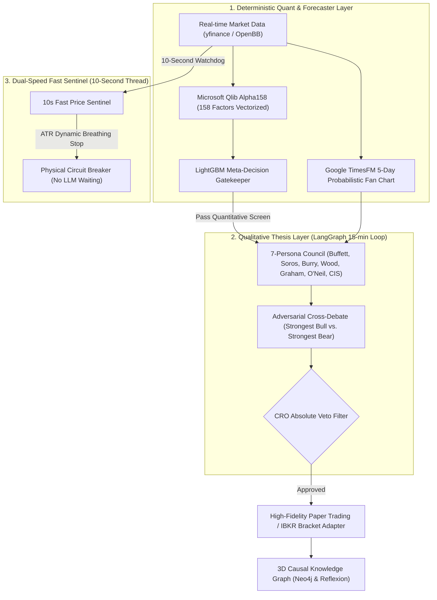

# From Toy Problem to Awesome-Quant: How My Solo-Engineered AI Hedge Fund Got Featured in the World’s #1 Quant Repository


## Introduction: The Day We Merged into the Quant Bible

In October 2026, my open-source autonomous AI hedge fund engine, **[Lumina Capital (v6.0)](https://github.com/ramuza0113-sketch/lumina-ai-hedge-fund)** (CC BY-NC 4.0), was officially accepted and merged into **[wilsonfreitas/awesome-quant](https://github.com/wilsonfreitas/awesome-quant)** (15,000+ GitHub Stars)—widely recognized as the definitive global directory for quantitative finance, algorithmic trading, and mathematical finance engineering.

[](https://github.com/wilsonfreitas/awesome-quant#trading--backtesting) [](https://github.com/ramuza0113-sketch/lumina-ai-hedge-fund/actions/workflows/ci.yml) [](https://github.com/ramuza0113-sketch/lumina-ai-hedge-fund/blob/main/docker-compose.yml)

Sitting in the **Trading & Backtesting** section alongside foundational quantitative platforms like Backtrader, Zipline, and Microsoft Qlib marks a significant milestone for what began as an independent research project.

Following the merge, repository traffic experienced an explosive surge: **total Git clones crossed 250+ (120+ unique cloners) in just a few days**, with top referring traffic flowing directly from `awesome-quant` and active discussions on Reddit (`r/Python` and `r/LangChain`).

In this post, I want to break down:
1. **The fatal flaws of first-generation "LLM trading bots"**
2. **The core architectural rule that earned global acceptance: *"Models reason, software calculates"***
3. **The technical stack: Microsoft Qlib Alpha158 + Google TimesFM + LangGraph + Neo4j**
4. **The step-by-step submission story: strict CI validation, resolving a PR merge conflict with creator Wilson Freitas, and launching 1-click Docker containerization**

---

## 1. Why Most Open-Source "AI Trading Bots" Fail in Real Markets

Over the past year, GitHub has seen a massive wave of multi-agent LLM trading repositories like `virattt/ai-hedge-fund` and `TradingAgents`. While conceptually inspiring, anyone running them against real tick data quickly encounters an unforgiving **execution realism gap**:

### Flaw 1: Mixing Arithmetic with Probabilistic Reasoning
Prompting an LLM to calculate moving averages, RSI, or cross-sectional factor rankings inevitably introduces silent token drift, rounding errors, and hallucinated prices. In algorithmic execution, a 0.2% arithmetic error can bankrupt a strategy.

### Flaw 2: Zero Market Friction Awareness
Most open-source bots calculate returns with 0% exchange fees and zero slippage. A strategy that appears to produce a smooth 45-degree equity curve in simulation often turns deeply negative the moment real 0.05% taker commissions and bid-ask spread slippage are subtracted.

### Flaw 3: Flash Crash Vulnerability & API Latency
When an asset flash-crashes, price drops occur within seconds. An LLM taking 15 to 30 seconds to stream tokens for a multi-paragraph debate cannot protect a portfolio in time.

---

## 2. The Core Philosophy: "Models Reason, Software Calculates"

To eliminate these vulnerabilities, Lumina Capital was architected under a strict separation of concerns:

> **"Models reason, software calculates."**

All quantitative math, factor scoring, and risk boundaries are executed deterministically in vectorized Python. LLMs are reserved exclusively for macro synthesis, SEC 10-K qualitative parsing, and anti-sycophancy thesis debates.



### Key Engineering Highlights:
- **Vectorized Microsoft Qlib Alpha158**:
  All 158 quantitative factors (volatility, momentum, price volume correlation, skewness) are computed purely in NumPy/Pandas. A LightGBM meta-decision tree filters out low-conviction signals before any LLM tokens are consumed.
- **Google TimesFM Probabilistic Fan Charts**:
  Instead of fragile single-point predictions, Google’s zero-shot foundation time-series model (TimesFM) generates 5-day probabilistic distributions across 50%, 80%, and 90% confidence bands.
- **LangGraph Anti-Sycophancy Deliberation**:
  7 distinct investor personas (Buffett, Soros, Burry, Wood, Graham, O'Neil, CIS) analyze assets in isolated parallel execution to prevent herd-following. Strongest Bull and Strongest Bear engage in an adversarial cross-debate grounded in SEC filings.
- **Chief Risk Officer (CRO) Irreversible Veto**:
  The CRO agent possesses hard veto authority (0% target allocation) if tail risks or accounting anomalies appear, overriding all bullish arguments.
- **Dual-Speed Sentinel Architecture**:
  A 15-minute deep deliberation loop is paired with an independent 10-second fast price sentinel. If volatility cascades, the sentinel triggers dynamic ATR breathing stops without waiting for API latency.
- **3D Causal Knowledge Graph & GraphRAG**:
  Stores trade reflections (Reflexion) and SEC 10-K supply-chain relationships into a Neo4j WebGL 3D graph to track multi-hop risk propagation (e.g., TSMC chip manufacturing chokepoints affecting NVIDIA).

---

## 3. Submitting to Awesome-Quant: The PR Drama & Wilson Freitas’s Resolution

With a comprehensive codebase and 100% GitHub Community Health standards (`CONTRIBUTING.md`, `CODE_OF_CONDUCT.md`, `CITATION.cff`, and automated CI testing via GitHub Actions), I submitted **Pull Request #803** to `wilsonfreitas/awesome-quant`.

### The Automated CI Gatekeeper
Awesome-quant handles dozens of submissions weekly, enforcing a strict automated validation workflow:
- Verifying HTTP 200 responses on all proposed URLs
- Enforcing strict alphabetical order within subcategories
- Duplicate detection
- Zero markdown syntax deviations

Our PR passed the CI test suite in just 12 seconds with all green checks.

### The Merge Conflict & Maintainer Collaboration
Shortly after submission, another pull request was merged into `awesome-quant`'s `main` branch, triggering a merge conflict on `README.md`.

In many large open-source repositories, a conflict results in automated closure or indefinite stalls. However, **Wilson Freitas, creator and maintainer of awesome-quant, stepped in directly**:

> *"The README merge conflict has been resolved locally, preserving the entries already on main and this PR's reviewed contribution. The resolved additions pass the repository's strict format, URL and duplicate checks."*

When GitHub’s Actions API encountered a temporary 403 secondary rate limit, Wilson calculated the exact reset window (13:42 UTC), committed the clean merge, and pushed the final resolution.

The pull request was formally **merged**, placing Lumina Capital permanently in the global directory.

---

## 4. Post-Merge Surge & 1-Click Docker Compose Launch

Within 48 hours of merging, traffic to the repository accelerated dramatically:
- **Total Clones**: Increased from 157 to **257+ (+100 in 24 hours)**
- **Unique Cloners**: Increased from 84 to **129+**
- **Top Referrers**: `github.com/wilsonfreitas/awesome-quant` and `reddit.com`

### Eliminating Friction: 1-Click Docker Compose
To ensure quantitative researchers and developers across macOS, Linux, and Windows could spin up the full platform without environment headaches, we introduced production-ready **Docker Compose** containerization:

```yaml
# docker-compose.yml snippet
services:
  lumina-studio:
    build: .
    ports:
      - "8501:8501"
    environment:
      - NEO4J_URI=bolt://neo4j:7687
    depends_on:
      neo4j:
        condition: service_healthy

  neo4j:
    image: neo4j:latest
    ports:
      - "7474:7474"
      - "7687:7687"
```

Now, any researcher worldwide can run:
```bash
git clone https://github.com/ramuza0113-sketch/lumina-ai-hedge-fund.git
cd lumina-ai-hedge-fund
cp .env.example .env
docker compose up
```
And access the full Streamlit dashboard and connected 3D Neo4j causal graph instantly at `http://localhost:8501`.

Best of all, the entire council runs smoothly on CPU with a **100% free Gemini API key from Google AI Studio**, requiring no expensive GPUs or paid OpenAI subscriptions.

---

## Conclusion & Looking Forward

Building and open-sourcing a complex financial engine as an independent developer was an ambitious undertaking. But committing to **execution realism**, maintaining **strict engineering discipline**, and providing a **frictionless developer experience** proved that rigorous open-source work can earn a place on the global stage.

Lumina Capital remains fully open-source under CC BY-NC 4.0 for research, education, and simulation.

If you are working on quantitative factor research, multi-agent systems, or algorithmic trading, check out the code, run the simulation, and consider starring the repository!

- 🏛️ **GitHub Repository**: [ramuza0113-sketch/lumina-ai-hedge-fund](https://github.com/ramuza0113-sketch/lumina-ai-hedge-fund)
- 🐦 **X (Twitter)**: [@prompter_note](https://x.com/prompter_note)
- 🌐 **Engineering Blog**: [prompter-note.com](https://prompter-note.com)
