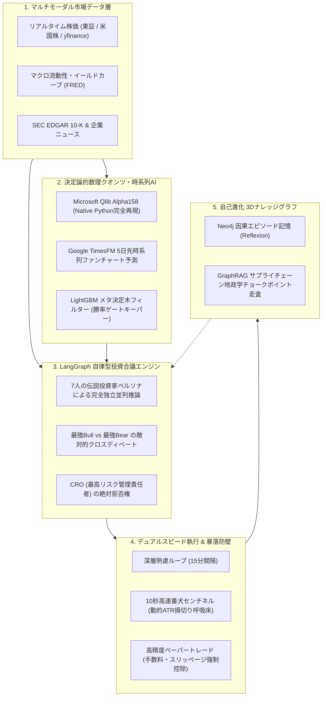

## はじめに：なぜ既存の「AI投資bot」は実戦で勝てないのか？

ここ数ヶ月、GitHub上では `virattt/ai-hedge-fund`（6.3万スター）や `TradingAgents`（4.4万スター）といった、LLMマルチエージェントを活用したAIヘッジファンドのオープンソースが世界的な熱狂を巻き起こしています。

しかし、これらのプロジェクトのコードを詳細に読み解き、実際に動かしてみると、ある**決定的な壁（Execution Realismの断絶）**に直面します：

1. **「推論」と「計算」が混同されている**  
   LLMにチャートの数値やファンダメンタルズ指標をそのまま読ませて直接「買い/売り」を判断させているため、ハルシネーション（もっともらしい嘘）や計算ミスが頻発する。
2. **手数料・スリッページ・流動性の無視**  
   バックテストでは勝てているように見えても、実際の市場摩擦（往復手数料、板スプレッドの不利約定）を引いた瞬間に利益が吹き飛ぶ。
3. **急落時の防衛機構（セーフティネット）の欠如**  
   LLMが長文で思考・議論している数分間の間に相場が急変した場合、損切りが間に合わず即死する。

こうした既存の課題を工学的に克服し、**「非構造化データのLLM合議」と「決定論的な数理クオンツ計算」を完全分離・統合した自律型AIヘッジファンドエンジン『Lumina Capital (v6.0)』** をゼロから開発しました。

本日、個人開発者や研究者がローカルで動かして検証できるよう、GitHubにてオープンソース（CC BY-NC 4.0）として公開しました。

> 🏆 **【速報】世界最大のクアント投資リソース集「awesome-quant（⭐️ 15,000+）」に公式採択・マージされました！**  
> 厳格な数理・フォーマット審査を経て、Trading & Backtesting部門に正式掲載されています。

🔗 **GitHubリポジトリ**:  
https://github.com/ramuza0113-sketch/lumina-ai-hedge-fund
*(もし参考になりましたら、GitHubの右上の「⭐️ Star」やQiitaの「LGTM」を押していただけると励みになります！)*

---

## 全体アーキテクチャの概要

本システムは「モデルは推論し、ソフトウェアが計算する」という金融AIの鉄則を徹底しています。



---

## コア技術のブレイクダウン

### 1. LangGraphによる「反迎合（Anti-Sycophancy）」マルチエージェント合議
LLMを対話させると、先行する意見や強い意見に他のエージェントが同調してしまう「迎合バイアス」が致命的になります。
本システムでは、以下の2段階アプローチをステートマシンとして厳格に分離しています：
- **フェーズ1（完全独立並列推論）**: ウォーレン・バフェット、ジョージ・ソロス、マイケル・バーリ、キャシー・ウッド、ベンジャミン・グレアム、ウィリアム・オニール、CISの7名が、他の意見を遮断された状態で個別に分析を実施。
- **フェーズ2（事実直結型クロスディベート）**: 最高評価の「最強Bull」と最低評価の「最強Bear」を対決させ、一次データ（決算書や指標）のみを論拠とした討論を強制。
- **CROの絶対拒否権**: どんなに合議スコアが高くても、リスク管理責任者（CRO）がテールリスクや不正会計を検知すれば割当0%に強制ロック。

### 2. Microsoft Qlib「Alpha158」のNative Python完全ベクトル化
Microsoft Researchが開発したクオンツ投資フレームワーク「Qlib」の中核であるAlpha158数理ファクター（ローリングボラティリティ、モメンタム、価格スプレッド等）を、重厚なC++コンパイルに依存せず、pure pandas/numpyで高速に完全再現しました。
これをLightGBMのメタ決定木に通すことで、ダマシのブレイクアウトを機械的に排除しています。

### 3. Google TimesFM による時系列確率ファンチャート
Google Researchの時系列基盤モデル「TimesFM」を統合し、過去株価のコンテキストから5日先までの価格パス、80%信頼区間、急落確率を定量的に算出します。

### 4. デュアルスピード・アーキテクチャ（10秒番犬センチネル）
「15分間隔の重いLLM合議スレッド」とは完全に独立して、**「10秒間隔の超高速番犬センチネルスレッド」**をマルチスレッドで常時監視させています。
ボラティリティに連動した「動的ATR呼吸床」と「フィボナッチ最適値 -13.0%ライン」を秒単位で物理監視し、市場急落時にはLLMのAPI呼び出しを待たずに即時強制決済を執行します。

### 5. Neo4jとGraphitiによる「3Dナレッジグラフ & GraphRAG」
過去の合議やトレードの勝因・敗因をNeo4jの3D空間に因果グラフとして永続化。さらにSECの10-Kからサプライチェーン依存関係（例: ASML ➔ TSMC ➔ NVIDIA）を自動抽出し、上流供給網の障害リスクを走査します。

---

## クイックスタート（1分で起動）

Python 3.10以上の環境があれば、数コマンドでローカル起動できます。

```bash
# 1. クローン
git clone https://github.com/ramuza0113-sketch/lumina-ai-hedge-fund.git
cd lumina-ai-hedge-fund

# 2. 依存パッケージのインストール
pip install -r requirements.txt

# 3. ダッシュボード起動
streamlit run app.py
```

ブラウザで `http://localhost:8501` を開くと、リアルタイム市場データを用いた自律型AI投資スタジオが立ち上がります。

---

## おわりに & コミュニティ

本プロジェクトは、学術・教育・研究用フレームワークとして公開しています（CC BY-NC 4.0）。
「個人利用やシミュレーションは完全無料」ですので、ぜひフォークやコードの検証、GitHubでのフィードバックをお待ちしております！

もし面白いと感じていただけたら、GitHubでの **Star（⭐）** を押していただけると大変励みになります！

- 🏛️ **GitHub**: https://github.com/ramuza0113-sketch/lumina-ai-hedge-fund
- 🐦 **X (Twitter)**: https://x.com/prompter_note
- 🌐 **公式ブログ**: https://prompter-note.com
- 📰 **note**: https://note.com/prompter_note
- 💬 **公式LINE**: https://lin.ee/U4TKsUN