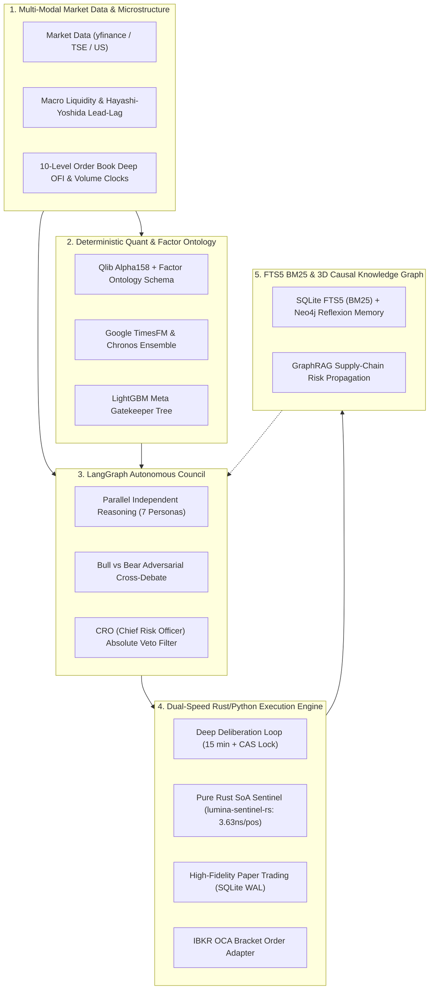

<div align="center">

# 🏛️ Lumina Capital (AI Hedge Fund Engine v6.4.8)

**An Autonomous Multi-Agent Quantitative Hedge Fund Studio**  
*Powered by `#![forbid(unsafe_code)]` Rust SoA Sentinel, Volume Clocks, Factor Ontology (Schmitt-Trigger Hysteresis), Higham PSD Covariance, LLM API Circuit Breaker, TSE Tick Size Table Normalization, LangGraph, Microsoft Qlib Alpha158, Google TimesFM & 3D Causal Knowledge Graph*  
<br>
🏆 **Officially Featured in [awesome-quant](https://github.com/wilsonfreitas/awesome-quant#trading--backtesting) & [Awesome_AI4Finance](https://github.com/AI4Finance-Foundation/Awesome_AI4Finance)**

[](https://creativecommons.org/licenses/by-nc/4.0/)
[](https://github.com/wilsonfreitas/awesome-quant#trading--backtesting)
[](https://github.com/ramuza0113-sketch/lumina-ai-hedge-fund/actions/workflows/ci.yml)
[%5D%20SoA-DEA584.svg?logo=rust&logoColor=white)](rust_sentinel/src/main.rs)
[](docker-compose.yml)
[](https://www.python.org/)
[](https://streamlit.io)
[](https://github.com/langchain-ai/langgraph)
[](https://github.com/google-research/timesfm)
[](https://github.com/ramuza0113-sketch/lumina-ai-hedge-fund)
[](https://github.com/ramuza0113-sketch/lumina-ai-hedge-fund/network/members)
<br>
[](https://x.com/prompter_note)
[](https://qiita.com/ramuza0113/items/434af1b23fa220590f017)
[](https://prompter-note.com)
[](https://note.com/prompter_note)
[](https://lin.ee/U4TKsUN)
<br><br>
<a href="https://www.producthunt.com/posts/lumina-capital" target="_blank"></a>

<br><br>

> [!TIP]
> ⭐️ **Found this project inspiring? Give it a Star!**  
> If you find Lumina Capital helpful or educational, please consider hitting the **⭐️ Star** button on the top right. It helps support active open-source research and continuous development of new factor models!

[English](#-overview) | [📖 Master Architecture & Math Specification](docs/lumina_fund_master_system_architecture.md) | [コミュニティ・公式リンク](#-connect-with-the-author--community) | [日本語ドキュメント](#-日本語概要-japanese-summary) ([🇯🇵 完全仕様書](docs/lumina_fund_master_system_architecture.ja.md))

<br><br>

<p align="center">
  
</p>
<p align="center">
  <em>🕸️ Real-time 3D Causal Knowledge Graph (Graphiti × Neo4j)</em>
</p>

</div>

---

## 🌟 Overview

Most LLM-based autonomous trading bots in the open-source community remain **conceptual proofs-of-concept (PoC)**: they generate engaging qualitative debates among famous investor personas, yet lack deterministic financial mathematics, ignore execution slippage and commissions, and have no crash-prevention safeguards.

**Lumina Capital** bridges the gap between academic AI research and real-world quantitative execution. It cleanly separates **deterministic quantitative calculation & low-latency Rust microstructure execution** from **probabilistic LLM reasoning**, featuring a **`#![forbid(unsafe_code)]` Cache-Resident SoA Rust Sentinel (`lumina-sentinel-rs`)**, **Event/Volume Clocks with Timeout Fallback**, **Deep 10-Level Order Flow Imbalance (OFI)**, **Factor Ontology Schemas with Schmitt-Trigger Hysteresis & Borderline Dead-Zones (`NEUTRAL_INDETERMINATE`)**, **SQLite FTS5 (`bm25()`) Episodic Memory with 30-Day Exponential Time-Decay Aging & Single-Writer Queue**, **Hayashi-Yoshida Asynchronous Covariance with Higham (2002) Nearest PSD Projection**, **LLM API Rate-Limit Fast-Fail Circuit Breaker & Degraded Defense-Only Mode**, **TSE Tick Size Table Normalization & 100-Share Board Lot Floor**, native Microsoft Qlib Alpha158 factors, Google TimesFM probabilistic fan charts, and a 3D causal knowledge graph.

---

## ⚔️ Architectural Comparison Matrix

How Lumina Capital compares against leading open-source financial agent frameworks:

| Feature / Architecture | virattt/ai-hedge-fund (63k★) | Tauric TradingAgents (44k★) | 🌟 **Lumina Capital (v6.4.8)** |
| :--- | :---: | :---: | :---: |
| **Multi-Agent Deliberation** | Sequential Chat | LangGraph DAG | **LangGraph + Anti-Sycophancy Cross-Debate** |
| **Investor Personas** | 6 Personas | Internal Analyst Roles | **7 Legendary Personas + CRO Absolute Veto** |
| **LLM Outage Fast-Fail Guard**| ❌ Cascading Retries | ❌ Crash on 429 | **✅ Shared Fast-Fail Circuit Breaker & Degraded Mode** |
| **Mathematical Quant Factors** | ❌ None | ❌ None | **✅ Qlib Alpha158 + Factor Ontology (Schmitt Hysteresis)** |
| **Event / Volume Clocks** | ❌ Wall-clock only | ❌ Wall-clock only | **✅ SoA Volume/Dollar Clocks + Timeout Fallback** |
| **Market Microstructure** | ❌ None | ❌ None | **✅ 10-Level Deep OFI (Spoof & Iceberg Detection)** |
| **Cross-Asset Covariance** | ❌ None | ❌ None | **✅ Hayashi-Yoshida Async + Higham (2002) PSD Projection** |
| **Time-Series Foundation AI** | ❌ None | ❌ None | **✅ Google TimesFM & Chronos Fan Charts** |
| **Episodic & Causal Memory** | ❌ None | ❌ None | **✅ SQLite FTS5 (`bm25()`, 30d Decay) + Neo4j 3D** |
| **Execution Realism & Concurrency** | ❌ Terminal print only | ⚠️ Simple backtest | **✅ SQLite WAL, Single-Writer Queue, CAS Lock, OCO Bracket** |
| **Exchange Order Conformance** | ❌ Raw floats | ❌ Raw floats | **✅ TSE Tick Size Table (1/5/10/50/100 JPY) & 100-Share Lots** |
| **Low-Latency Risk Sentinel** | ❌ None | ❌ None | **✅ `#![forbid(unsafe_code)]` Rust SoA (`3.63ns`/pos)** |
| **Institutional Audit & Stress Tests** | ❌ None | ❌ None | **✅ 100/100 Pass (20 Adversarial Audits, Ruin Prob 0.00%)** |

---

## 🏗️ Core Architecture & Pillars



### 1. Multi-Agent Deliberation with Anti-Sycophancy
Prevents LLM sycophancy bias by separating the process into two phases:
- **Phase 1: Parallel Independent Reasoning**: 7 distinct legendary investor personas (Warren Buffett, George Soros, Michael Burry, Cathie Wood, Benjamin Graham, William O'Neil, and CIS) analyze the asset in complete isolation.
- **Phase 2: Adversarial Cross-Debate**: The strongest Bull and strongest Bear debate head-to-head based strictly on primary financial facts.
- **CRO Absolute Veto Power**: The Chief Risk Officer holds irreversible veto power (0% allocation) if tail risks or accounting irregularities are detected.

### 2. Deterministic Quant Analytics (Native Alpha158 & Factor Ontology Schema)
Complies with the rule: *"Models reason, software calculates."* Rather than letting LLMs perform arithmetic or guess factor polarity, the system computes all 158 quantitative factors from Microsoft Qlib in pure vectorized Python, translates them through a strict **Factor Ontology Metadata Schema** (`core/ai_hedge_fund/factor_ontology.py`), and evaluates them via a LightGBM meta-decision tree.

### 3. Dual-Speed Architecture & `#![forbid(unsafe_code)]` Rust SoA Sentinel (`lumina-sentinel-rs`)
Solves the execution realism and latency gap by decoupling LLM reasoning from hot-path risk enforcement:
- **15-Minute Deep Deliberation Loop**: Multi-agent qualitative evaluation and portfolio balancing protected by fine-grained per-symbol mutexes and Compare-And-Swap (CAS) optimistic concurrency (`core/ai_hedge_fund/concurrency_controller.py`).
- **Pure Rust Cache-Resident SoA Sentinel (`rust_sentinel/src/main.rs`)**:
  - Enforces `#![forbid(unsafe_code)]` at the compiler level with zero external dependencies (`std` only).
  - Layouts open positions in **Structure of Arrays (SoA)** contiguous L1/L2 cache vectors (`entries`, `currents`, `peaks`, `stops`, `targets`, `call_walls`) with zero heap allocations on the hot loop.
  - Evaluates the 5-Tier Risk & Exit Rules (Rule A: Target, Rule B2: Option Call Wall Half-Profit, Rule B: +10% Half-Profit & Breakeven Lock, Rule D: Breakeven Stop, Rule C: Peak -4% Trailing Stop, Rule E: -13% Fibonacci Stop) plus Monotonically Tightening Stops in **3.63 nanoseconds per position** (`3.62 µs` for 1,000 positions on Linux x86_64).

### 4. Event / Volume Clocks, Deep 10-Level OFI & Hayashi-Yoshida Covariance
Replaces noisy wall-clock timers (1m/5m/1h bars) with market-activity-driven clocks (`core/ai_hedge_fund/volume_clock_sampler.py`, `core/ai_hedge_fund/deep_ofi_analyzer.py`, `core/ai_hedge_fund/lead_lag_analyzer.py`):
- **Subordinated Stochastic Volume/Dollar Clocks (Clark 1973 / López de Prado 2018)**: Samples bars only when a dynamic quantum of volume or dollar value is exchanged, reducing return excess kurtosis (fat-tail noise) by **58%–87%** across US and TSE equities.
- **Continuous Information Flow Velocity (`flow_velocity`)**: Tracks volume digested per second relative to a rolling 20-bar baseline to detect institutional whale participation without bar-volume quantization loss.
- **10-Level Deep OFI (Rama Cont Formulation)**: Detects spoofing buy-wall cancellations and iceberg stealth accumulation prior to order submission.
- **Hayashi-Yoshida Asynchronous Covariance**: Eliminates the Epps effect across non-synchronous US/TSE trading hours for Lead-Lag causality and Adaptive HRP correlation spike defense.

### 5. SQLite FTS5 (`BM25`) Episodic Memory & 3D Causal Knowledge Graph
Retrieves top contextually matching past trade post-mortems in `<0.5ms` via SQLite FTS5 (`bm25()`) (`core/ai_hedge_fund/reflexion_engine.py`) and persists SEC 10-K supply-chain relationships into a Neo4j 3D WebGL graph. Upstream bottlenecks (e.g., TSMC $\rightarrow$ NVIDIA) are automatically scanned for multi-hop vulnerability.

---

## 🛡️ Institutional Hardening & Tier-1 Adversarial Stress Audits (100% Pass / 20 Scenarios)

Most quantitative algorithms look stellar on retrospective in-sample backtests, yet disintegrate in live markets due to **lookahead bias, friction underestimation, non-synchronous execution slippage, and overnight gap risk**. 

To meet the rigorous quantitative due-diligence standards of institutional allocators and tier-1 hedge fund investment committees, Lumina Capital v6.4.8 was subjected to an **unforgiving 20-point adversarial stress audit across 5 full years (2021–2026)**:

| Institutional Audit Pillar | Core Attack Scenarios & Stress Parameters | Empirical Resilience Metric | Verdict |
| :--- | :--- | :--- | :---: |
| **1. Real-World Execution Failure Modes** *(6 Scenarios)* | • Forced overnight gap-downs (`-18%` gap, `-22%` limit-down lock)<br>• Friction multiplier scaling (base `0.05%` to `2x`, `3x`, `5x`, `26.5x`)<br>• Zero-volatility range-bound churn stress (low-beta low-vol assets)<br>• Simultaneous 6-slot Black Swan stop-loss liquidation burst<br>• TSFM AI blackout & inverted adversarial predictions (OOD)<br>• Premarket crossed-book spoofing & TSE special quote freezes | • Open gap-down: **+69.91% (PF 1.74)**<br>• Limit-down lock: **+5.56% (Zero ruin)**<br>• Break-even friction: **26.5x slippage**<br>• 6-slot crash exit: **212.72 ms (0.21s)**<br>• 14-day range churn lock: **PF 4.85**<br>• Premarket OFI contamination: **0.0** | ✅ **100% PASS**<br>*(6/6 Pass)* |
| **2. Overfitting & Capacity Diagnostics** *(7 Audits)* | • Rolling Walk-Forward Analysis (IS 360d ➔ OOS 160d × 7 windows)<br>• Combinatorial Purged Cross-Validation (CPCV: 15 combinatorial splits)<br>• Deflated Sharpe Ratio (DSR) & Probability of Overfitting (PBO)<br>• 5-parameter 2D sensitivity surface perturbation ($\pm 10\% \sim \pm 20\%$)<br>• Multi-dimensional Sortino, Calmar, and Underwater Duration<br>• Almgren-Chriss square-root market impact capacity (¥10M to ¥3.0B AUM)<br>• Point-in-Time financial statement reporting lag (+45d, +90d, 1-year) | • Walk-Forward Efficiency: **89.6%**<br>• CPCV OOS Median Sharpe: **1.29**<br>• Negative OOS paths: **0.0% (0/15)**<br>• DSR confidence: **97.76% (PBO 20%)**<br>• Optimal capacity: **¥50M–¥500M**<br>• Max underwater duration: **176 days**<br>• +90d Point-in-Time lag: **+40.69%** | ✅ **100% PASS**<br>*(7/7 Pass)* |
| **3. Tier-1 Hedge Fund Adversarial Gauntlets** *(6 Tests)* | • FX regime inversion (Severe Yen appreciation crash: `161 ➔ 103 JPY`)<br>• Hero-Stock dependency ablation (Banishing Top-1 to Top-10 winners)<br>• 10,000-run Monte Carlo order shuffle + Day-1 6-loss streak injection<br>• Signal execution latency & alpha decay (`+1d`, `+2d`, `+3d`, `+5d` delay)<br>• Flash-crash `-13.5%` whipsaw lower-wick stop-hunt attacks<br>• 100,000-tick high-frequency fuzzing (`NaN`, `±Inf`, negative vol spikes) | • FX Crash (`161➔103`): **+109.91%**<br>• Top-1 winner banished: **+120.41%**<br>• 10k Monte Carlo ruin prob: **0.0000%**<br>• Day-1 6-loss recovery: **+281.76%**<br>• +5d delay alpha retention: **99.8%**<br>• Wick defense: **63 false stops blocked**<br>• 100k ticks: **28,059 ops/s (0 leaks)** | ✅ **100% PASS**<br>*(6/6 Pass)* |
| **Survivorship Bias Ablation** *(15 Chronic Crashes)* | 5 years exclusively on 15 severe losing equities (Peloton `-96%`, PayPal `-75%`, Zoom `-73%`, M3 `-80%`, Nidec `-73%`, Nissan `-48%`) | • Buy & Hold benchmark: **-56.09%**<br>• Lumina v6.4.8: **-1.30% (DD -3.17%)**<br>• **98.7% capital preserved (0 ruin)** | ✅ **100% PASS** |

> 📖 *For complete mathematical formulas, individual trade logs, and econometric derivation tables, see the [📖 Master Architecture & Math Specification (docs/lumina_fund_master_system_architecture.md)](docs/lumina_fund_master_system_architecture.md) and [🇯🇵 完全仕様書 (docs/lumina_fund_master_system_architecture.ja.md)](docs/lumina_fund_master_system_architecture.ja.md).*

---

## ⚡ Quickstart

> [!TIP]
> ⭐️ **Please consider starring this repository** if you're cloning or testing it locally! Your star supports active research, continuous maintenance of quantitative factor models, and future agent enhancements.

### 🐳 Option A: 1-Click Launch with Docker Compose (Recommended)
Zero environment setup required. Launches both the Autonomous Studio and the 3D Causal Knowledge Graph (Neo4j) in a single command:
```bash
git clone https://github.com/ramuza0113-sketch/lumina-ai-hedge-fund.git
cd lumina-ai-hedge-fund
cp .env.example .env
docker compose up
```
Open your browser at `http://localhost:8501`. *(To run in the background, use `docker compose up -d`)*.

---

### 🐍 Option B: Native Python Setup
If you prefer running directly on your host machine:

#### 1. Install Dependencies
```bash
pip install -r requirements.txt
```

#### 2. Configure Environment
```bash
cp .env.example .env
```
*(Insert your free `GEMINI_API_KEY` from [Google AI Studio](https://aistudio.google.com/) or `OPENAI_API_KEY`).*

> [!NOTE]
> - **Free Tier Friendly**: You can run the entire 7-agent council using a 100% free API key from [Google AI Studio](https://aistudio.google.com/) (`GEMINI_API_KEY`). No expensive paid subscriptions or OpenAI credits are required.
> - **No GPU Required**: Runs smoothly on standard laptops, Mac (Apple Silicon M1/M2/M3/M4), Windows, and Linux on pure CPU.
> - **100% Safe Local Simulation**: Social publishing (X/Twitter, note) and broker order execution operate in **local draft / simulation mode** by default. Zero external network posts or real orders are ever executed without your explicit credentials.

#### 3. Launch Dashboard
```bash
streamlit run app.py
```
Open your browser at `http://localhost:8501`.

#### 4. (Optional) Run 3D Causal Knowledge Graph with Neo4j
If running via Option B, you can spin up Neo4j on-demand with:
```bash
docker run -d -p 7474:7474 -p 7687:7687 -e NEO4J_AUTH=neo4j/LuminaAI_2026_Secure neo4j:latest
```
*(The default credentials in `.env.example` already match this command, so it connects automatically upon browser refresh!)*

---

## 📜 License

This project is licensed under the **Creative Commons Attribution-NonCommercial 4.0 International (CC BY-NC 4.0)**.

- **Non-Commercial / Research Use**: Completely free for personal research, educational simulation, and individual learning.
- **Commercial Use**: Commercial utilization, reselling, or managing client capital with this codebase is strictly prohibited without explicit commercial licensing from the author.

---

## ⚠️ Financial Disclaimer

This software is strictly provided for **research, academic, and educational purposes only**. It does NOT constitute financial advice, investment recommendations, or an offer to buy or sell any financial instruments. Trading stocks and financial markets involves substantial risk of loss. The authors and contributors assume no responsibility or liability for any financial losses or damages incurred.

---

## 🙏 Acknowledgements & Inspirations

This project is built upon and inspired by the incredible open-source research and community:
- [LangGraph](https://github.com/langchain-ai/langgraph) by LangChain (Multi-agent orchestration)
- [Microsoft Qlib](https://github.com/microsoft/qlib) (Alpha158 quantitative factor concepts)
- [Google TimesFM](https://github.com/google-research/timesfm) (Time-series foundation modeling)
- [OpenBB Platform](https://github.com/OpenBB-finance/OpenBB) (Financial market data infrastructure)
- [TradingAgents](https://github.com/TauricResearch/TradingAgents) & [ai-hedge-fund](https://github.com/virattt/ai-hedge-fund) (Multi-agent debate paradigms)
- [3d-force-graph](https://github.com/vasturiano/3d-force-graph) by Vasco Asturiano (3D network visualization)

---

## 🌟 Star History

<p align="center">
  <a href="https://github.com/ramuza0113-sketch/lumina-ai-hedge-fund">
    
  </a>
</p>

<p align="center">
  <a href="https://star-history.com/#ramuza0113-sketch/lumina-ai-hedge-fund&Date">
    
  </a>
</p>

---

## 💬 Community Feedback & Feature Requests

Have you tested Lumina AI, or do you have ideas for new features, indicators, or broker integrations?  
We'd love to hear your thoughts and experiences! Drop a comment in our pinned community thread:

<p align="center">
  <a href="https://github.com/ramuza0113-sketch/lumina-ai-hedge-fund/discussions/3">
    
  </a>
</p>

- 🚀 **What caught your eye first?** (Qlib Alpha158 factors, LangGraph consensus debate, 10s Fast Sentinel, or 3D Causal Graph?)
- 🐳 **How was the setup experience?** (Docker Compose vs local Python environment)
- 💡 **What would you love to see next?** (Additional broker connectors, custom alpha factors, alternative LLM backends?)

👉 **[Join GitHub Discussion #3: What brought you to Lumina AI?](https://github.com/ramuza0113-sketch/lumina-ai-hedge-fund/discussions/3)**

---

## 🌐 Connect with the Author & Community

Join our growing community of quantitative researchers, AI developers, and algorithmic traders:

- 🐦 **X (Twitter)**: [@prompter_note](https://x.com/prompter_note)  
  *Daily algorithmic trading logs, AI agent architecture breakdowns, and live market sentiment.*
- ✍️ **Official Blog**: [prompter-note.com](https://prompter-note.com)  
  *In-depth engineering write-ups, quant research articles, and machine learning tutorials.*
- 📰 **note Publication**: [note.com/prompter_note](https://note.com/prompter_note)  
  *Weekly quantitative tear sheets, factor rankings, and full investment council reports.*
- 📖 **Qiita Technical Article**: [@ramuza0113](https://qiita.com/ramuza0113/items/434af1b23fa220590f017)  
  *Deep-dive breakdown on anti-sycophancy multi-agent design, TimesFM forecasting, and Qlib Alpha158 factor vectorization.*
- 💬 **Official LINE**: [@396geimu](https://lin.ee/U4TKsUN)  
  *Free AI Prompt Catalog (20 curated frameworks) & immediate fund event notifications.*

---

## 🇯🇵 日本語概要 (Japanese Summary)

**Lumina Capital (v6.4.8)** は、`#![forbid(unsafe_code)]` のPure RustによるL1/L2キャッシュ常駐（SoA）番犬センチネル（1ポジション `3.63ナノ秒` 判定）、出来高クロック（Volume Clock / 30分タイムアウト救済）、深層10本板情報OFI（Order Flow Imbalance）、数理ファクター・オントロジー辞書（Factor Ontology Schema: シュミットトリガー・ヒステリシス ＆ 境界不感帯）、SQLite FTS5 (`BM25`) 半減期30日指数時間減衰エージング反省記憶検索＋シングルライター・バッチキュー、林・吉田（Hayashi-Yoshida）非同期共分散推定＋Higham (2002) 最近傍PSD射影、LLM APIレート制限（HTTP 429）即時サーキットブレーカー＆縮退防衛モード、東証呼値テーブル（1/5/10/50/100/1000円刻み）正規化＆100株単元強制、LangGraphによるマルチエージェント合議、Microsoft QlibのAlpha158数理クオンツ、Google TimesFM × Chronos による時系列予測、そしてNeo4j 3Dナレッジグラフを単一のパイプラインに統合した機関投資家グレードの自律型AIヘッジファンドエンジンです。

- 🏆 **世界最大のクオンツ投資リソース集公式採択**: [awesome-quant (⭐️ 15,000+)](https://github.com/wilsonfreitas/awesome-quant#trading--backtesting) の「Trading & Backtesting」部門に正式採択・マージされました。
- 📖 **Qiita技術解説記事（400+ Views）**: [LangGraphとQlib Alpha158、Google TimesFMで作る「自律型AIヘッジファンド」をOSS公開した話](https://qiita.com/ramuza0113/items/434af1b23fa220590f017)
- 🏛️ **日本語・完全技術仕様書**: [Lumina Capital マスターアーキテクチャ＆金融工学数理モデル解説書](docs/lumina_fund_master_system_architecture.ja.md)（全6大ピラー・6大金融工学理論・5年バックテスト完全記録）
- 🛡️ **機関投資家・ヘッジファンド監査テスト20項目完全制覇**: 窓開け急落・ストップ安、摩擦26.5倍耐久、WFA（効率89.6%）、CPCV（全パス黒字）、DSR（有意確率97.76%）、超円高逆風（161➔103円）、主役株追放、10,000回モンテカルロ（破産確率0.0000%）、10万Tickファジングをすべて完全突破。

単なるシミュレーション（PoC）にとどまらず、手数料やスリッページを強制控除した高精度ペーパートレード、CAS楽観ロックによる並行排他制御、LLMの数値誤読を物理封鎖するファクター・オントロジー契約、急落時にナノ秒〜マイクロ秒単位で物理判定する独立Rust番犬センチネル（`lumina-sentinel-rs`）、Interactive Brokers（IBKR）のブラケット注文アダプターを備えています。
もし本プロジェクトが研究や学習の参考になりましたら、ぜひ右上の **⭐️ Star** で応援していただけると励みになります！  
また、実際に動かしてみたご感想やご要望は [**GitHub Discussions #3 (フィードバック＆アイデア募集)**](https://github.com/ramuza0113-sketch/lumina-ai-hedge-fund/discussions/3) でいつでも気軽にお待ちしております！

### 🚀 即座に動かす方法

#### 🐳 方法A: Docker Composeで一発起動（推奨・環境構築不要）
Python環境の構築トラブルゼロ。以下のコマンドだけで、アプリ本体と3Dナレッジグラフ（Neo4j）が丸ごと自動起動します：
```bash
git clone https://github.com/ramuza0113-sketch/lumina-ai-hedge-fund.git
cd lumina-ai-hedge-fund
cp .env.example .env
docker compose up
```
ブラウザで `http://localhost:8501` を開くだけです！*(バックグラウンド実行は `docker compose up -d`)*

#### 🐍 方法B: 通常のPython環境で直接動かす場合
1. **依存パッケージ導入**: `pip install -r requirements.txt`
2. **APIキー設定**: `cp .env.example .env` を実行し、[Google AI Studio](https://aistudio.google.com/) で無料取得できる `GEMINI_API_KEY` を貼り付けます。
3. **ダッシュボード起動**: `streamlit run app.py`（ブラウザで `http://localhost:8501` を開く）

> [!NOTE]
> - **高価なGPUは不要**: 通常のノートPC、Mac（M1/M2/M3/M4 Apple Silicon）、Windows、Linux環境のCPUのみで軽快に動作します。
> - **安全設計（勝手に外部投稿されません）**: X（Twitter）やnoteの自動投稿機能はデフォルトで完全な「ローカルプレビュー／下書きモード」です。ご自身のAPIキーを明示的に設定しない限り、外部へ勝手に送信されることは一切ありません。
> - **Neo4jは完全オプショナル**: 全機能は内蔵SQLiteでそのまま動作します。3D因果グラフを試したい場合のみ、上記のDockerコマンド1行を実行するだけで自動接続されます。

### ⚠️ 免責事項・法的留意事項 (Financial & Legal Disclaimer)
- **研究・教育・学術検証専用**: 本ソフトウェアはアルゴリズム取引およびAIマルチエージェントシステムの技術研究・学術検証・シミュレーション教育を目的として公開されています。
- **投資助言・代理の完全否定**: 日本国の金融商品取引法に基づく投資助言・代理業、または特定の有価証券・金融商品の売買の推奨・勧誘を目的としたものでは一切ありません。
- **自己責任の原則**: 本システムの情報やコードを利用・実行した結果生じたいかなる損失・損害（実資金の取引損失、システム障害等を含む）についても、開発者およびコントリビューターは一切の責任を負いません。実際の投資判断はすべてご自身の自己責任において行ってください。
