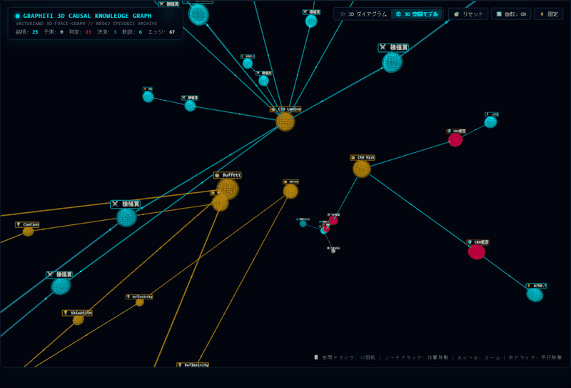
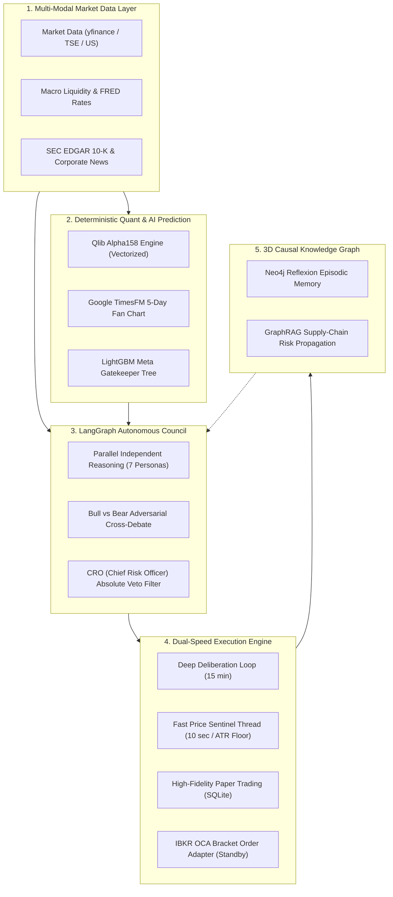

<div align="center">

# 🏛️ Lumina Capital (AI Hedge Fund Engine v6.0)

**An Autonomous Multi-Agent Quantitative Hedge Fund Studio**  
*Powered by LangGraph, Microsoft Qlib Alpha158, Google TimesFM & 3D Causal Knowledge Graph*

[](https://creativecommons.org/licenses/by-nc/4.0/)
[](https://www.python.org/)
[](https://streamlit.io)
[](https://github.com/langchain-ai/langgraph)
[](https://github.com/google-research/timesfm)
<br>
[](https://x.com/prompter_note)
[](https://prompter-note.com)
[](https://note.com/prompter_note)
[](https://lin.ee/U4TKsUN)
<br><br>
<a href="https://www.producthunt.com/posts/lumina-capital" target="_blank"></a>

[English](#-overview) | [コミュニティ・公式リンク](#-connect-with-the-author--community) | [日本語ドキュメント](#-日本語概要-japanese-summary)

<br><br>

<p align="center">
  
</p>
<p align="center">
  <em>🕸️ Real-time 3D Causal Knowledge Graph (Graphiti × Neo4j)</em>
</p>

</div>

---

## 🌟 Overview

Most LLM-based autonomous trading bots in the open-source community remain **conceptual proofs-of-concept (PoC)**: they generate engaging qualitative debates among famous investor personas, yet lack deterministic financial mathematics, ignore execution slippage and commissions, and have no crash-prevention safeguards.

**Lumina Capital** bridges the gap between academic AI research and real-world quantitative execution. It cleanly separates **deterministic quantitative calculation** from **probabilistic LLM reasoning**, featuring native Microsoft Qlib Alpha158 factors, Google TimesFM probabilistic fan charts, a 3D causal knowledge graph, and a high-fidelity paper trading engine with mandatory fee and slippage deductions.

---

## ⚔️ Architectural Comparison Matrix

How Lumina Capital compares against leading open-source financial agent frameworks:

| Feature / Architecture | virattt/ai-hedge-fund (63k★) | Tauric TradingAgents (44k★) | 🌟 **Lumina Capital** |
| :--- | :---: | :---: | :---: |
| **Multi-Agent Deliberation** | Sequential Chat | LangGraph DAG | **LangGraph + Anti-Sycophancy Cross-Debate** |
| **Investor Personas** | 6 Personas | Internal Analyst Roles | **7 Legendary Personas + CRO Absolute Veto** |
| **Mathematical Quant Factors** | ❌ None | ❌ None | **✅ Qlib Alpha158 (Native Vectorized Python)** |
| **Time-Series Foundation AI** | ❌ None | ❌ None | **✅ Google TimesFM & Chronos Fan Charts** |
| **Causal Memory & GraphRAG** | ❌ None | ❌ None | **✅ Neo4j 3D Knowledge Graph & Supply Chain** |
| **Execution Realism** | ❌ Terminal print only | ⚠️ Simple backtest | **✅ High-Fidelity SQLite, Fees & Slippages** |
| **Live Broker Connectors** | ❌ None | ❌ None | **✅ IBKR Bracket Order & Kabu-Station Adapters** |
| **Dual-Speed Sentinel** | ❌ None | ❌ None | **✅ 10s Fast Price Sentinel + Dynamic ATR Floor** |

---

## 🏗️ Core Architecture & Pillars



### 1. Multi-Agent Deliberation with Anti-Sycophancy
Prevents LLM sycophancy bias by separating the process into two phases:
- **Phase 1: Parallel Independent Reasoning**: 7 distinct legendary investor personas (Warren Buffett, George Soros, Michael Burry, Cathie Wood, Benjamin Graham, William O'Neil, and CIS) analyze the asset in complete isolation.
- **Phase 2: Adversarial Cross-Debate**: The strongest Bull and strongest Bear debate head-to-head based strictly on primary financial facts.
- **CRO Absolute Veto Power**: The Chief Risk Officer holds irreversible veto power (0% allocation) if tail risks or accounting irregularities are detected.

### 2. Deterministic Quant Analytics (Native Alpha158)
Complies with the rule: *"Models reason, software calculates."* Rather than letting LLMs perform arithmetic, the system computes all 158 quantitative factors from Microsoft Qlib in pure vectorized Python, evaluated through a LightGBM meta-decision tree.

### 3. Dual-Speed Architecture & Execution Realism
Solves the execution realism gap by running two independent threads:
- **15-Minute Deep Deliberation Loop**: Multi-agent qualitative evaluation and portfolio balancing.
- **10-Second Fast Price Sentinel**: LLM-independent price guard monitoring dynamic ATR breathing floors and executing emergency exits without waiting for LLM API latency.

### 4. Self-Evolving 3D Causal Knowledge Graph
Persists trade reflections (Reflexion) and SEC 10-K supply-chain relationships into a Neo4j 3D WebGL graph. Upstream bottlenecks (e.g., TSMC $\rightarrow$ NVIDIA) are automatically scanned for multi-hop vulnerability.

---

## ⚡ Quickstart

### 1. Clone the Repository
```bash
git clone https://github.com/ramuza0113-sketch/lumina-ai-hedge-fund.git
cd lumina-ai-hedge-fund
```

### 2. Install Dependencies
```bash
pip install -r requirements.txt
```

### 3. Setup Environment Variables
Copy `.env.example` to `.env` and insert your API keys:
```bash
cp .env.example .env
```
*(At minimum, insert `GEMINI_API_KEY` or `OPENAI_API_KEY` for the AI Council).*

### 4. Launch the Autonomous Studio
```bash
streamlit run app.py
```
Open your browser at `http://localhost:8501`.

---

## 📜 License

This project is licensed under the **Creative Commons Attribution-NonCommercial 4.0 International (CC BY-NC 4.0)**.

- **Non-Commercial / Research Use**: Completely free for personal research, educational simulation, and individual learning.
- **Commercial Use**: Commercial utilization, reselling, or managing client capital with this codebase is strictly prohibited without explicit commercial licensing from the author.

---

## ⚠️ Financial Disclaimer

This software is strictly provided for **research, academic, and educational purposes only**. It does NOT constitute financial advice, investment recommendations, or an offer to buy or sell any financial instruments. Trading stocks and financial markets involves substantial risk of loss. The authors and contributors assume no responsibility or liability for any financial losses or damages incurred.

---

## 🙏 Acknowledgements & Inspirations

This project is built upon and inspired by the incredible open-source research and community:
- [LangGraph](https://github.com/langchain-ai/langgraph) by LangChain (Multi-agent orchestration)
- [Microsoft Qlib](https://github.com/microsoft/qlib) (Alpha158 quantitative factor concepts)
- [Google TimesFM](https://github.com/google-research/timesfm) (Time-series foundation modeling)
- [OpenBB Platform](https://github.com/OpenBB-finance/OpenBB) (Financial market data infrastructure)
- [TradingAgents](https://github.com/TauricResearch/TradingAgents) & [ai-hedge-fund](https://github.com/virattt/ai-hedge-fund) (Multi-agent debate paradigms)
- [3d-force-graph](https://github.com/vasturiano/3d-force-graph) by Vasco Asturiano (3D network visualization)

---

## 🌟 Star History

<p align="center">
  <a href="https://star-history.com/#ramuza0113-sketch/lumina-ai-hedge-fund&Date">
    
  </a>
</p>

---

## 🌐 Connect with the Author & Community

Join our growing community of quantitative researchers, AI developers, and algorithmic traders:

- 🐦 **X (Twitter)**: [@prompter_note](https://x.com/prompter_note)  
  *Daily algorithmic trading logs, AI agent architecture breakdowns, and live market sentiment.*
- ✍️ **Official Blog**: [prompter-note.com](https://prompter-note.com)  
  *In-depth engineering write-ups, quant research articles, and machine learning tutorials.*
- 📰 **note Publication**: [note.com/prompter_note](https://note.com/prompter_note)  
  *Weekly quantitative tear sheets, factor rankings, and full investment council reports.*
- 💬 **Official LINE**: [@396geimu](https://lin.ee/U4TKsUN)  
  *Free AI Prompt Catalog (20 curated frameworks) & immediate fund event notifications.*

---

## 🇯🇵 日本語概要 (Japanese Summary)

**Lumina Capital** は、LangGraphによるマルチエージェント合議、Microsoft QlibのAlpha158数理クオンツ、Google TimesFMによる時系列予測、そしてNeo4j 3Dナレッジグラフを単一のパイプラインに統合した機関投資家グレードの自律型AIヘッジファンドエンジンです。

単なるシミュレーション（PoC）にとどまらず、手数料やスリッページを強制控除した高精度ペーパートレード、急落時に10秒単位で物理執行する独立番犬センチネル、Interactive Brokers（IBKR）のブラケット注文アダプターを備えています。
個人での研究・学習目的には完全無料（CC BY-NC 4.0）でご利用いただけます。

### ⚠️ 免責事項・法的留意事項 (Financial & Legal Disclaimer)
- **研究・教育・学術検証専用**: 本ソフトウェアはアルゴリズム取引およびAIマルチエージェントシステムの技術研究・学術検証・シミュレーション教育を目的として公開されています。
- **投資助言・代理の完全否定**: 日本国の金融商品取引法に基づく投資助言・代理業、または特定の有価証券・金融商品の売買の推奨・勧誘を目的としたものでは一切ありません。
- **自己責任の原則**: 本システムの情報やコードを利用・実行した結果生じたいかなる損失・損害（実資金の取引損失、システム障害等を含む）についても、開発者およびコントリビューターは一切の責任を負いません。実際の投資判断はすべてご自身の自己責任において行ってください。
