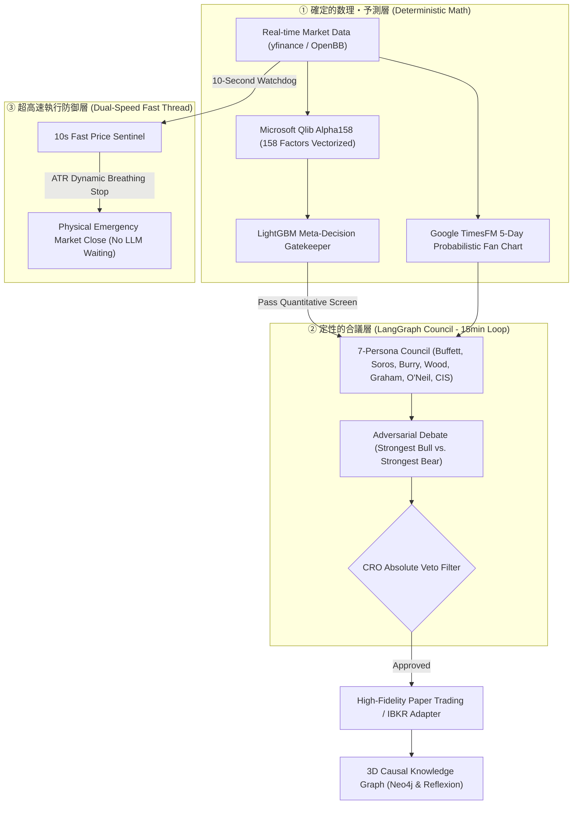

# 個人開発の自律型AIヘッジファンドが、世界最大の『awesome-quant（⭐️15,000+）』に公式採択されるまでの全記録


## はじめに：世界最大のクアント投資リソース集にマージされた日

2026年10月、個人で開発・オープンソース公開（CC BY-NC 4.0）している自律型AIヘッジファンドエンジン**『Lumina Capital (v6.0)』**が、GitHub上で世界最大の金融工学・アルゴリズム取引リソース集である**[wilsonfreitas/awesome-quant](https://github.com/wilsonfreitas/awesome-quant)（GitHub Star 15,000+）の公式「Trading & Backtesting」部門に正式採択・マージ**されました。

[](https://github.com/wilsonfreitas/awesome-quant#trading--backtesting)
[](https://github.com/ramuza0113-sketch/lumina-ai-hedge-fund/actions/workflows/ci.yml)
[](https://github.com/ramuza0113-sketch/lumina-ai-hedge-fund/blob/main/docker-compose.yml)

Backtrader、Zipline、Microsoft Qlib といった世界の名だたるクアント投資フレームワークが並ぶリストの中に、日本の個人開発リポジトリが公式に名を連ねることになりました。

採択後、海外からのアクセスとクローン（Git Clone）は急増し、**わずか数日で総クローン数は250回、ユニーククローナー数は120人を突破**。海外掲示板のReddit（`r/Python` や `r/LangChain`）でも数千インプレッションを記録し、熱狂的な反響が寄せられています。

本記事では、
1. **なぜ巷の「LLM投資bot（PoC）」は実戦で勝てないのか？**
2. **世界に通用した基本思想：「Models reason, software calculates（モデルは推論し、ソフトウェアが計算する）」**
3. **Microsoft Qlib × Google TimesFM × LangGraph × Neo4j の統合アーキテクチャ**
4. **世界最大のAwesomeリポジトリにPRを送り、オーナー直々の神対応でマージを勝ち取るまでの全記録**

を、余すところなく技術的に公開します。

---

## 1. なぜ既存の「LLM投資bot」はおもちゃで終わるのか？

ここ1〜2年、GitHub上では `virattt/ai-hedge-fund`（6万+ Stars）などを筆頭に、LLMマルチエージェントを用いた投資シミュレーションが世界的なトレンドとなっています。

しかし、これらのコードをクローンして徹底的に検証したとき、現場のアルゴリズムトレーダーやクアント研究者が感じるのは**「決定的なリアリズム（Execution Realism）の断絶」**です。

多くのプロジェクトは、以下の**3つの致命的欠陥**を抱えています：

### ① 推論と計算の混同（Hallucination on Arithmetic）
「プロンプト内でChatGPTにテクニカル指標（RSIや移動平均）を計算させ、そのまま売買判断をさせる」ような設計です。LLMは言語確率モデルであり、四則演算や浮動小数点演算を平気でハルシネーション（幻覚）します。0.1%の計算狂いが破産を招く金融市場において、これは致命傷です。

### ② 市場摩擦（Friction）の完全無視
多くのPoCは「取引手数料」や「スリッページ（板の厚みによる不利約定）」を一切控除していません。手数料0のバックテストでは綺麗な右肩上がりの資産曲線を描けても、実相場に投入した瞬間に手数料負けして資金が溶けていきます。

### ③ 急落時の防衛機構（セーフティネット）の欠如
LLMがAPIを経由して長文の議論（合議）を行っている時間は、短くても15秒〜30秒かかります。しかし相場のフラッシュクラッシュ（瞬間急落）は秒単位で発生します。エージェントが「現在の市場環境について考察中…」とトークンを生成している間に、ポートフォリオはロスカットされずに大暴落に飲み込まれます。

---

## 2. Lumina Capitalの工学的解決策：「Models reason, software calculates」

この壁を突破するために設計したのが、Lumina Capitalの中核哲学です：

> **「Models reason, software calculates（モデルは推論し、ソフトウェアが計算する）」**

定量的な数理計算は100%確定的なプログラムに任せ、LLMには定性的なシナリオ分析・戦略合議にのみ専念させるという完全な責務分離を行いました。



### アーキテクチャの5大特徴

1. **Microsoft Qlib「Alpha158」の完全ベクトル化実装**:
   LLMには一切計算をさせず、マイクロソフトの金融工学ライブラリ「Qlib」が提唱する158種類のアルファファクター（モメンタム、ボラティリティ、リターン歪度等）を、NumPy / Pandas のみを用いて純粋なPythonで超高速計算。さらに前段に配置したLightGBMメタ決定木が、勝率の低いシグナルを機械的に遮断します。
2. **Google TimesFM による5日先確率ファンチャート**:
   Googleの基底時系列モデル「TimesFM」を統合。単一の点予測ではなく、50%、80%、90%の信頼区間を持った確率的ファンチャートをリアルタイムプロットします。
3. **LangGraphによる「反迎合（Anti-Sycophancy）」7人合議**:
   バフェット、ソロス、バーリ、ウッド、グレアム、オニール、CISの7人の独立エージェントが、互いの意見を見ずに並列で分析。その後、最強の強気派と最強の弱気派が一騎打ちの論戦（クロスディベート）を実施。最高リスク責任者（CRO）は、粉飾リスクやマクロ急変を検知した瞬間に「割当0%（絶対拒否権）」を発動します。
4. **デュアルスピード・アーキテクチャ（Dual-Speed Sentinel）**:
   15分サイクルの「LLM深層合議ループ」とは完全に独立して、**10秒周期の「高速番犬センチネルスレッド」**が常時並行稼働。急落時はLLMのAPI完了を1秒も待たず、動的ATRフロアに基づいて物理的に即時強制エグジットします。
5. **3D因果ナレッジグラフ & GraphRAG (Neo4j & Graphiti)**:
   トレードの事後反省（Reflexion）やSEC 10-Kサプライチェーンの依存関係をNeo4j 3D WebGLグラフに永続蓄積。TSMC → NVIDIA のような地政学的なボトルネック連鎖を多段ホップで追跡します。

---

## 3. 世界最大の『awesome-quant』への挑戦とマージまでのドラマ

Lumina Capitalを公開後、世界中のクアントコミュニティが最も信頼するバイブルである **`wilsonfreitas/awesome-quant`（⭐️15,000+）** に掲載申請（Pull Request #803）を行いました。

### 厳格な自動テストの洗礼
このリポジトリは、世界中から毎日無数のPRが送られてくるため、CIテスト（`Validate PR`）が極めて厳格です：
- URLが現在200 OKで生存しているか
- セクション内でアルファベット順（A-Z）に正しくソートされているか
- リスト内で重複していないか
- マークダウンの記述規約に1ミリのズレもないか

ローカルで完全検証した上でPRを提出し、自動CIテストをわずか12秒でオールグリーンで通過しました。

### 突如発生したマージコンフリクトと、オーナー直々の神対応
しかし、直前で他のPRがマージされたことにより、`README.md` 上で競合（コンフリクト）が発生してしまいました。

通常、大規模な海外オープンソースでは「コンフリクトを直してプッシュし直せ」と突き放されるか、長期間放置されるのが日常茶飯事です。

ところが、数時間後、awesome-quantのファウンダーである **Wilson Freitas 氏本人が直々にPRコメントに登場** しました：

> *"The README merge conflict has been resolved locally, preserving the entries already on main and this PR's reviewed contribution. The resolved additions pass the repository's strict format, URL and duplicate checks."*  
> （「READMEのコンフリクトは手元で綺麗に解消したよ。既存のエントリを保持しつつ、今回のPRの貢献内容もしっかり反映した。追加内容はうちの厳格なフォーマット・URL・重複チェックをすべて合格しているよ。」）

なんと、オーナー自らが手元でコンフリクトを解消し、コミットを作成してくれたのです。

さらに直後、GitHub APIのレートリミット（403エラー）が発生するトラブルに見舞われましたが、Wilson 氏は制限解除時刻（13:42 UTC）を正確に計算し、自ら再プッシュを実行。

そして日本時間の深夜、**公式にプルリクエストが「🟣 Merged」され、Trading & Backtesting 部門への公式掲載が完了**しました。

---

## 4. マージ後に起きたこと：トラフィック爆発と「Docker Compose」対応

マージされた直後から、GitHubリポジトリの Insights（アナリティクス）に劇的な変化が起きました。

- **総クローン数**: 157回 ➜ **257回へ急増（+100回 / 日）**
- **ユニーククローナー**: 84人 ➜ **129人へ急増（+45人 / 日）**
- **トップリファラー**: `github.com/wilsonfreitas/awesome-quant` および `reddit.com` からの海外流入が上位を独占。

### 「環境構築で挫折させない」ためのDocker Compose 1発起動化
海外のエンジニアが流入してきた際、最も避けなければならないのが「Pythonの依存関係やNeo4jのセットアップでエラーが出て離脱されること」です。

そこで、直近のアップデートで **Docker Compose（`docker compose up`）環境** をフル装備しました：

```yaml
# docker-compose.yml (抜粋)
services:
  lumina-studio:
    build: .
    ports:
      - "8501:8501"
    environment:
      - NEO4J_URI=bolt://neo4j:7687
    depends_on:
      neo4j:
        condition: service_healthy

  neo4j:
    image: neo4j:latest
    ports:
      - "7474:7474"
      - "7687:7687"
```

これにより、世界中のユーザーは以下のわずか2行を実行するだけで、ブラウザ（`http://localhost:8501`）を開けば**アプリ本体も3D因果グラフ（Neo4j）も最初からフル接続された状態でワンクリック起動**できるようになりました：

```bash
git clone https://github.com/ramuza0113-sketch/lumina-ai-hedge-fund.git
cd lumina-ai-hedge-fund
cp .env.example .env
docker compose up
```

さらに、**「Google AI Studioで無料発行できるGemini APIキー1本で全エージェントが動作する（有料API・GPU不要）」** という設計思想も、世界中のローカル開発者から絶大な支持を集める要因となっています。

---

## おわりに：個人の情熱は、海を越えて世界の一流に届く

英語圏の巨大なOSSコミュニティや、何万人ものプロが集まる金融工学の世界に飛び込むのは、最初は勇気がいる挑戦でした。

しかし、
- 「おもちゃのLLMプロンプト」ではなく**「本物の数理・執行リアリズム」**を追求すること
- 「Models reason, software calculates」という**明快な工学的規律**を守ること
- コントリビューション規約やCIテストなど、**グローバル基準の品質**を妥協なく整えること

を貫いた結果、世界最大のコミュニティの門番たちがその価値を認め、正式に仲間として迎え入れてくれました。

本プロジェクトは、学術・教育・研究を目的とした完全オープンソース（CC BY-NC 4.0）として公開を続けています。
ぜひローカルやDockerで動かしてみて、コードの検証やフィードバックをいただけると嬉しいです。

もし本プロジェクトの設計思想やコードに少しでも共感していただけましたら、GitHubリポジトリへの **⭐️ Star（スター）** で応援していただけると、今後の開発の大きな励みになります！

- 🏛️ **GitHub リポジトリ**: [ramuza0113-sketch/lumina-ai-hedge-fund](https://github.com/ramuza0113-sketch/lumina-ai-hedge-fund)
- 🐦 **X (Twitter)**: [@prompter_note](https://x.com/prompter_note)
- 🌐 **公式ブログ**: [prompter-note.com](https://prompter-note.com)
- 📰 **Qiita 第一弾記事**: [LangGraphとQlibで作る自律型AIヘッジファンドの設計思想](https://qiita.com/ramuza0113/items/434af1b23fa220590f017)
